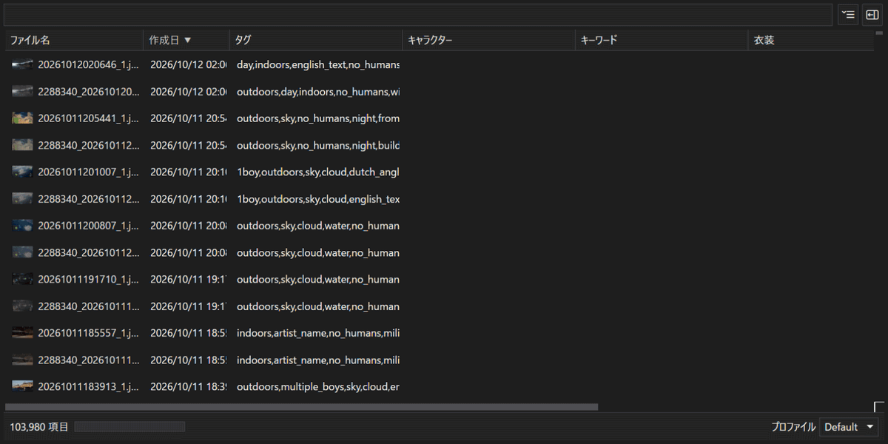

# Imoone
物凄い量(ン万枚)の画像からインデックスを生成し、タグ付けして割と早く検索するツール

# スクリーンショット
#### 常用環境(画像数10万枚)での動作　


## コンポーネント
1. **ImogeIndexWPF** インデックス生成ツール
2. **ImooneWPF** *ImogeIndexWPF* が生成したインデックスを検索するツール
    - 後述のクエリーを用いた検索
    - 知覚/平均/差分/DWTを使ったガバガバ類似画像検索

## インストール
https://github.com/sazae657/Imoone/releases/latest からバイナリ(ImooneWPF-*.zip)をダウンロードして適当なフォルダーに展開してください。

[使い方はこちら](#imoonewpfの使い方)

[の検索方法はこちら](#imoonewpf-の検索方法)

## 対応している画像フォーマット
[ImageMagick](https://imagemagick.org/formats/#supported) の対応フォーマットを参照

## 動作環境
### 必須要件
- .NET10
- x64 版 **Windows11 24H2** 以降の Windows (Windows MLの要件)
- それなりに潤沢なメモリ

### 推奨要件
- [Windows ML対応GPU](https://learn.microsoft.com/ja-jp/windows/ai/new-windows-ml/supported-execution-providers?tabs=winml2)
    - CPUでも動くが、タグ付けに**かなり**時間がかかります

## タグ付けモデル
SmilingWolf 氏の WaifuDiffusion Tagger 及び派生モデルと Cameron 氏の Camie Tagger で動作確認しています

#### 1. WaifuDiffusion Tagger (推奨)
`model.onnx` 及び `selected_tags.csv` が必要です

私が常用しているモデル : [wd-eva02-large-tagger-v3](https://huggingface.co/SmilingWolf/wd-eva02-large-tagger-v3)

#### 2. Camie Tagger
`*.onnx` 及び `*-metadata.json` が必要です

膨大なタグが生成される為、Thresholdの調整が必要かもしれません

動作確認済みモデル : [camie-tagger-v2](https://huggingface.co/Camais03/camie-tagger-v2)

## VLM によるキャプション付け

http リクエスト経由での `ollama`/`llama.cpp`/`Chat Completions API (lms等)` を使用したキャプション付けに対応しています

| バックエンド | 動作確認モデル | 備考 |
| ---- | ---- | --- |
| ollama (**推奨**) |  qwen3-vl-8b | |
| llama.cpp |  Qwen3VL-8B-Instruct-Q4_K_M.gguf + mmproj-Qwen3VL-8B-Instruct-F16.gguf | 私の環境では、不定期に500エラーや空の応答が返る事がある |
| lms (Chat Completions API経由) | qwen3-vl-8b | 私の環境では、1万枚毎程推論すると llmster のデーモンが落ちる事がある |

**注意 : VLM はローカル環境の物を想定しているので、クラウドサービスの物では確認していません(大量の画像を投げるので、物凄くお金が掛かると思います)**

## 実運用例

私は作業用 PC の他に VLM 用のマシンがあり、キャプション付けは VLM 用マシンでネットワーク経由で行っています

- 作業用 PC
    - OS : Windows11 25H2
    - GPU : NVIDIA Geforce RTX 4070Ti
    - タグ付けモデル : [wd-eva02-large-tagger-v3](https://huggingface.co/SmilingWolf/wd-eva02-large-tagger-v3)

- VLM 用マシン
    - OS : OpenSUSE Leap 16
    - GPU : NVIDIA RTX PRO 4000 Blackwell
    - VLM実行環境 : ollama
    - VLMモデル : [qwen3-vl:8b](https://ollama.com/library/qwen3-vl:8b)

## ImooneWPFの使い方

1. `ImooneWPF.exe` を起動します
2. 初回はインデックスが無いのでインデックス作成ツールを起動します
    - メニューもしくは `Ctrl+Q`

### ショートカットキー
| キー | 機能 |
| ---- | ---- |
| `Enter` | 選択している画像を関連付けられているアプリで開く |
| `Shift+Enter` | 選択している画像を含むフォルダーを開く |
| `Ctrl+Shift+C` | 選択している画像のパスをクリップボードへコピー |
| `Alt+D` | 検索ワード入力欄へフォーカス |
| `Ctrl+Shift+P` | 詳細表示の表示切り替え |
| `Ctrl+W` | 詳細表示のクリア |
| `Ctrl+Shift+W` | 詳細表示をクリア、詳細表示を閉じてリスト表示にする (緊急事態等用) |
| `Ctrl+Shift+R` | データの再読み込み |
| `Ctrl+Q` | インデックス作成ツールの起動 |
| `Ctrl+Shift+1` | 特大アイコン表示 |
| `Ctrl+Shift+2` | 大アイコン表示 |
| `Ctrl+Shift+3` | 中アイコン表示 |
| `Ctrl+Shift+4` | 小アイコン表示 |
| `Ctrl+Shift+6` | リスト表示 |
| `Ctrl+,` | アプリケーションの終了 |

## インデックス作成ツール (ImogeIndexWPF.exe) の使い方
1. `ImogeIndexWPF.exe` を起動します
2. 「⚙」→「設定」からインデックスするフォルダー及びタグ付けモデルの設定を行います
    - 初期状態では `Pictures` のみが設定されています
    - キャプショニングの設定もここから行います(初期状態では無効)
3. 「開始」ボタンを押すとインデックス作成が始まります
    - 最初は非常に時間が掛かるので、待ちきれなくなったらいつでも停止できます (何処で飽きても比較的ギリギリの位置から再開できるよう設計してあります)

### ショートカットキー
| キー | 機能 |
| ---- | ---- |
| `Ctrl+S` | インデックス作成開始 |
| `Ctrl+P` | 設定画面表示 |
| `Ctrl+O` | 現在のプロファイルの設定フォルダーを開く |
| `Ctrl+M` | `ImogeIndex` のデータフォルダーを開く |
| `Ctrl+W` | 正規表現練習帳を開く |
| `Ctrl+,` | アプリケーションの終了 |

### 制限事項
- NTFSの仕様上、ファイルの上書きではフォルダーの更新日付が変わらない為、**高速スキャン** ではファイルの上書きを取りこぼします
- 面倒くさいので、[再解析ポイント](https://learn.microsoft.com/ja-jp/windows/win32/fileio/reparse-points)には対応していません

### コマンドライン引数

いくつかのコマンドライン引数を受けることで自動実行ができます

| 引数 | 短縮形 |  |
| ---- | ---- | --- |
| `--auto` | `-a` | 起動したらインデックスを作成して終了する |
| `--profile プロファイル名` | `-p` | 指定したプロファイルをアクティブにして起動  |
| `--quick-scan` | `-q` | ファイル探索を高速スキャンモードで実行 (**NTFSの都合上ファイルの上書きは検知できない**) |
| `--no-window` | `-n` |  ウインドウを表示せずタスクトレイにアイコン表示して実行 |

私はインデックスの追加更新をする為に `--auto --quick-scan --no-window` で OS スタートアップ時に実行しています

## データや設定など
`AppData\Local\ImogeIndex` に保存されます( `ImogeIndexWPF`の「⚙」→「データフォルダーを開く」、Explorer から攻めるなら `%LOCALAPPDATA%\ImogeIndex`)

データや設定は全てここにあるので、アンインストール時はこのフォルダーをゴミ箱に捨ててください

データ保存先は環境変数 `IMOGEINDEX_HOME` でオーバーライドできます

- `Profile.toml`
    Imoone は複数のプロファイルを切り替える事ができます

    新しいプロファイルを生やす場合は、`Profiles`にプロファイル名を記述し、`ImogeIndexWPF` を起動します
    ```
    プロファイル名 = { Path = 'データを置くフォルダー' }
    ```

    `Profile.toml`の内容(初期状態)
    ```toml
    # デフォルトプロファイル
    Default = "Default"
    # プロファイル
    [Profiles]
    Default = { Path = 'Profiles\Default' }
    ```
- `.DS_Store` : `ImogeIndexWPF`/`ImooneWPF` の設定(自動保存)

### プロファイルフォルダーの中身
- `Config.toml` : 設定
- `*.db` : データベース
- `Logs\*.log` : インデックスツールのログ

# ImooneWPF の検索方法

- [通常検索](#通常検索)
  - [日付検索](#日付検索)
  - [解像度検索](#解像度検索)
  - [メタデータ検索](#メタデータ検索)
    - [対応しているタグ](#対応しているタグ)
    - [文字列タグの検索](#文字列タグの検索)
    - [数値タグの検索](#数値タグの検索)
- [ラベル付けと検索](#ラベル付けと検索)
- [類似画像の検索](#類似画像の検索)
- タガーで付けたタグの検索
  - [タグ](#タグで検索)
  - [キャラクター](#キャラクター)
- VLMで付けたキャプションの検索
  - [キーワード](#キーワード)
  - [写っているオブジェクト](#写っているオブジェクト)
  - [シーン](#シーン)
  - [衣装](#衣装)


### 基本ルール
- **検索ワード** をスペース区切りで絞り込みます(AND検索)
- `|` で区切るとOR検索になります
- `-` 検索ワードの頭に `-` を付けると否定になります
    - 通常検索で `-` から始まるファイル等を検索する場合は`"`で囲みます(例: `"-鼻エステ"`)
- スペースを含むワードで検索する場合は `"` で囲みます

### 通常検索
- フォルダー名若しくはファイル名を入力するとその名前で絞り込みます
- スペースを含むファイル名を検索する場合は `"` で囲みます

### 日付検索
*dc:YYYY[-MM[-DD[Thh[:mm[:ss]]]]]* で作成日付検索を行います


| 日付書式 | 例 | |
| ---- | ---- | --- |
| `YYYY` |  dc:2013 | *2013年* |
|` YYYY-MM` |  dc:2013-04 | *2013年4月* |
| `YYYY-MM-DD` |  dc:2013-04-09 | *2013年4月9日* |
| `YYYY-MM-DDThh` |  dc:2013-04-09T12 | *2013年4月9日の12時* |
| `YYYY-MM-DDThh:mm` |  dc:2013-04-09T12:30 | *2013年4月9日の12時30分* |
| `YYYY-MM-DDThh:mm:ss` |  dc:2013-04-09T12:30:39 | *2013年4月9日の12時30分39秒* |

日付の前に条件を付ける事ができます

| 条件 | 例 | 意味 |
| ---- | ---- | --- |
| `>` |  dc:>2013 | *2013年* より後 |
| `>=` |  dc:>=2013 | *2013年* 以降 |
| `<` |  dc:<2013 | *2013年* より前 |
| `<=` |  dc:<=2013 | *2013年* 以前 |

日付`-`日付 で範囲指定が出来ます(もちろん条件との併用は出来ません)

| 条件 | 例 | 意味 |
| ---- | ---- | --- |
| `dc:2013-01-2015-10-21` | *2013年1月1日0時0分0秒* から *2015年10月21日0時0分0秒* の間 |

### 解像度検索
*width:size* 幅で検索

*height:size* 高さで検索

| 例 | 意味 |
| ---- | ---- |
| `width:1920` | 幅が *1920 pixel* |
| `height:1080` | 高さが *1080 pixel* |
| `width:1920 height:1080` | *1920x1080 pixel* |

サイズの前に条件を付ける事ができます

| 条件 | 例 | 意味 |
| ---- | ---- | --- |
| `>` | width:>1920 | *1920 pixel* より大きい |
| `>=` |  width:>=1920 | *1920 pixel* 以上 |
| `<` |  width:<1920 | *1920 pixel* より小さい |
| `<=` |  width:<=1920 | *1920 pixel* 以下 |

サイズ`-`サイズ で範囲指定が出来ます(もちろん条件との併用は出来ません)

|  例 | 意味 |
| ---- | ---- |
| `width:1440-1920` | *1440 pixel* から *1920 pixel* の間 |

## メタデータ検索
ExifやPNG Info等から抽出したメタデータで検索します

*meta:Tag:Value*

#### 対応しているタグ

| タグ | 種類 | 意味 |
| ---- | ---- | ---- |
| `make` | 文字列 | メーカー |
| `model` | 文字列 | カメラのモデル |
| `lens` | 文字列 | レンズ |
| `software` | 文字列 | ソフトウェア |
| `iso` | 数値 | iso |
| `exposure` | 数値 | シャッタースピード |
| `aperture` | 数値 | 絞り |
| `focal` | 数値 | 焦点距離 |

#### 文字列タグの検索
| 例 | 意味 |
| ---- | ---- |
| `meta:make:canon` | *Canon* のカメラで撮影された画像 |
| `meta:model:eos` | *EOS* というカメラで撮影された画像 |
| `meta:model:"eos 5d"` | *EOS 5D* というカメラで撮影された画像 |
| `meta:lens:24-70` | 名前に *24-70* を含むレンズ |
| `meta:software:photoshop` | *Photoshop* で作成された画像 |

#### 数値タグの検索
- シャッタースピード等で一般的な分数表記も受け付けます
- 条件を付ける事ができます (*解像度検索* 辺りを参照)

| 例 | 意味 |
| --- | --- |
| `meta:iso:400` | ISO感度が*400* と等しい |
| `meta:iso:>400` | *ISO 400* より大きい |
| `meta:iso:>=400` | *ISO 400* 以上 |
| `meta:iso:<800` | *ISO 800* 未満 |
| `meta:iso:<=800` | *ISO 800* 以下 |
| `meta:iso:100-800` | *ISO 100* 以上 *ISO 800* 以下 |
| `meta:exposure:0.008` | 露光時間が *0.008 秒* と等しい |
| `meta:exposure:<=1/125` | 露光時間が *1/125 秒* 以下 |
| `meta:exposure:1/1000-1/125` | 露光時間が *1/1000 秒* 以上 *1/125 秒* 以下 |

### ラベル付けと検索

`ImooneWPF` にて`画像を右クリック`→`ラベル`でラベル付けができます(ラベルは同メニューの`編集`から好きな物を定義できます)

#### ラベル検索
*label:ラベル*

| 例 | 意味 |
| ---- | ---- |
| `label:★★★` | *★★★* というラベルを付けた物で絞り込み |

`label:*` と検索すると、ラベルが付いている全ての画像で絞り込みます

### 類似画像の検索

`ImooneWPF` にて`画像を右クリック`→`類似画像を検索`で類似画像を検索して絞り込みます(そこまで精度は高くありません)

`☰` → `類似検索に使うハッシュ`で `知覚/平均/差分/DWT` から任意のハッシュの組み合わせを選択可能です。　


## タガー及びVLMで付けたタグやキーワードでの検索

### タグで検索
*tag:TagName*

| 例 | 意味 |
| ---- | ---- |
| `tag:pizza` | タグに *pizza* を含む |
**※タグ付けが行われていること**

### キャラクター
*character:CharacterName*

| 例 | 意味 |
| ---- | ---- |
| `character:hinata_yukari` | キャラクターに *hinata_yukari* を含む |
**※タグ付けが行われていること**

### キーワード

*kwd:Keyword*

| 例 | 意味 |
| ---- | ---- |
| `kwd:寺社仏閣` | キーワードに寺社仏閣が含まれている |
**※VLMによるキャプション付けが行われていること**

### 写っているオブジェクト

*object:Object*

| 例 | 意味 |
| ---- | ---- |
| `object:ピザ` | ピザが写っている |
**※VLMによるキャプション付けが行われていること**

### シーン

*scene:Scene*

| 例 | 意味 |
| ---- | ---- |
| `scene:夕暮れ` | VLMが夕暮れだと視認した |
**※VLMによるキャプション付けが行われていること**

### 衣装

*costume:Costume*

| 例 | 意味 |
| ---- | ---- |
| `costume:奈良眼鏡` | 奈良眼鏡を着用している |
**※VLMによるキャプション付けが行われていること**

## ビルド方法
1. Visual Studioで `Imoone.slnx` を開く
2. `F7` キーを押す

## ライセンス
[ZLIB License](LICENSE)

